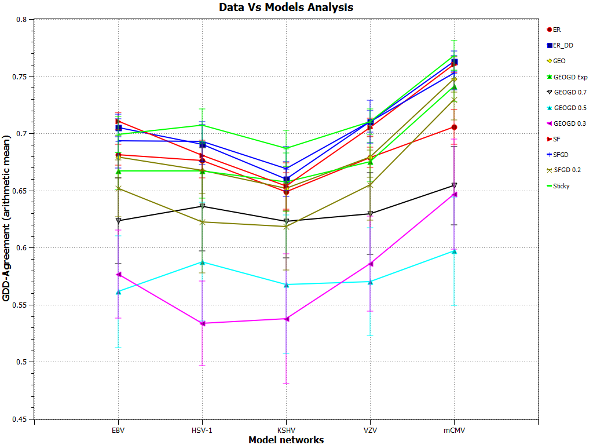
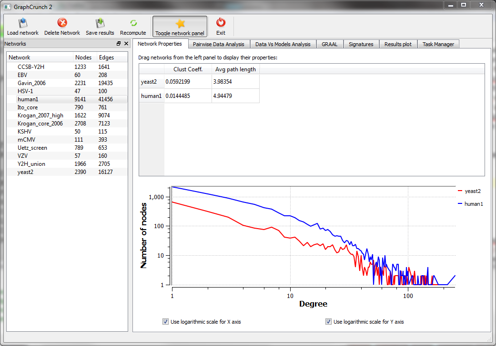
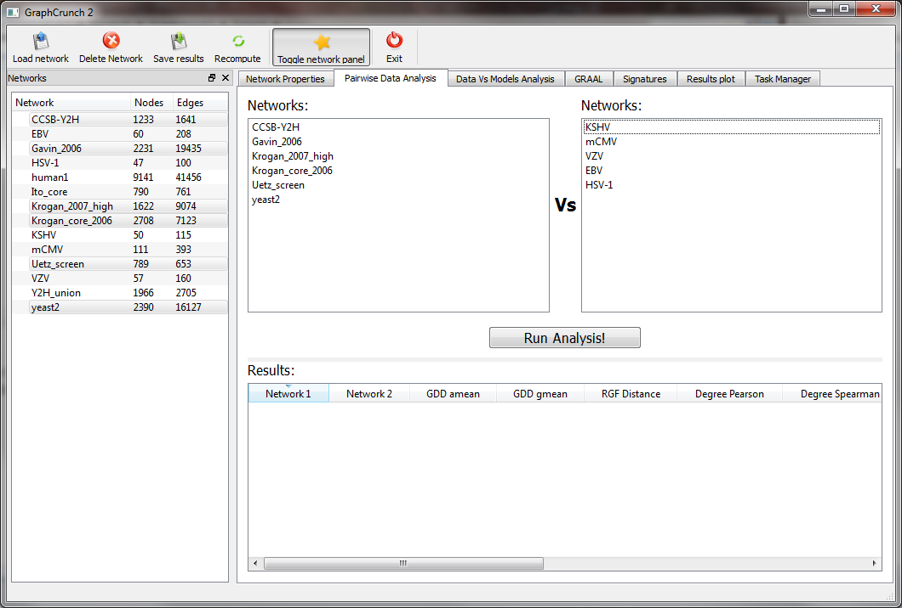
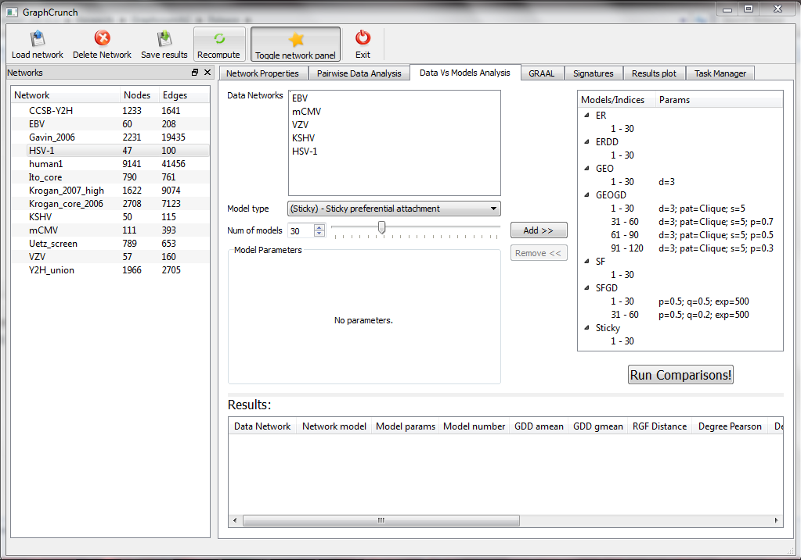
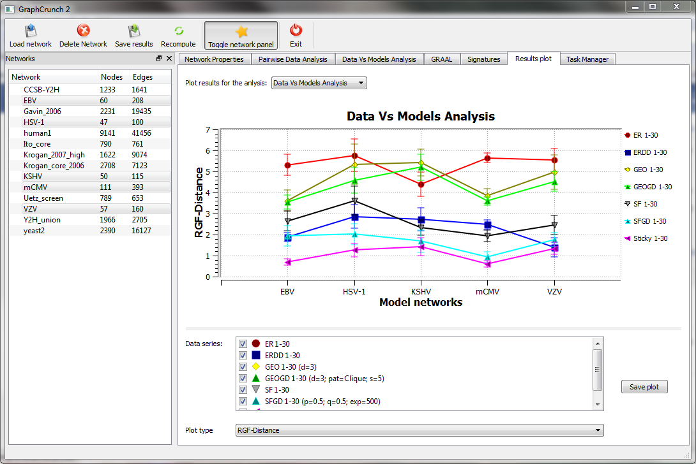
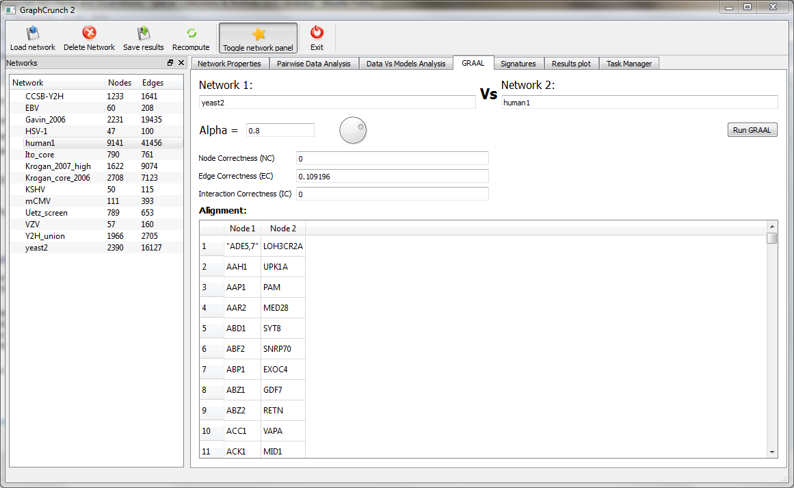
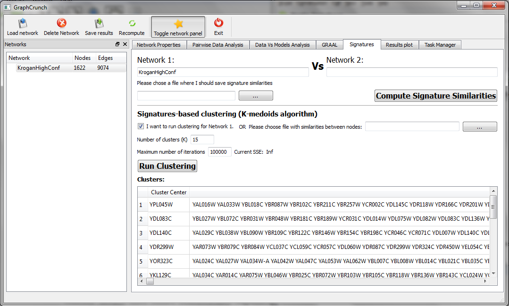

# GraphCrunch 2

### Software tool for network modeling, alignment and clustering

**Oleksii Kuchaiev, Aleksandar Stevanović, Wayne Hayes and Nataša Pržulj**

Corresponding author: Prof. N. Pržulj, natasa.przulj@mbzuai.ac.ae

[About](#about) · [Download](#download) · [User manual](#user-manual) · [MI-GRAAL](#mi-graal) · [Screenshots](#screenshots) · [Citation](#citation)

## About

GraphCrunch 2 is a new version of our [GraphCrunch](https://github.com/przulj-lab/GraphCrunch) software tool for network analysis, modeling and alignment. It automates finding the best-fitting model for network data, pairwise comparisons of networks, and alignment of two networks using the [GRAAL](https://github.com/przulj-lab/GRAAL) algorithm. It can also cluster network nodes based on their topological surroundings in the network.

- **Fast:** runs tasks in parallel on all available cores and processors.
- **Easy to use:** a drag-and-drop interface, so new users quickly become proficient with typical use cases.
- **Robust:** long computations can be stopped and resumed, previous results are reused without recomputing, and work is recovered after hardware failures or interruptions without losing data.

For a detailed description, see the [BMC Bioinformatics paper](https://doi.org/10.1186/1471-2105-12-24).

> [!NOTE]
> **Update:** the results in Figure 2 of the paper are slightly affected by the update in version 2.1. The updated figure is below.

**GDD-agreement between the viral PPI networks and the model networks.** Points on the horizontal axis are the viral PPI networks of the EBV, HSV-1, KSHV, VZV and mCMV herpesviruses. Lines correspond to different model networks. The vertical axis shows the average GDD-agreement between each data network and the model networks. For each data network, we generated 30 model instances of the same size as the data. The plot shows the averages and standard deviations of GDD-agreement; higher values mean the networks are more similar. Generated with GraphCrunch 2.1.1.

## Download

> [!IMPORTANT]
> A bug was fixed in version 2.1.1. If you downloaded GraphCrunch 2 before 3 April 2011, please download the updated version below.

- [GraphCrunch 2 – Windows 32-bit](https://github.com/przulj-lab/GraphCrunch-2/releases/download/v2.1.1/GraphCrunchV2.1.1-Win32.zip)
- [GraphCrunch 2 – Windows 64-bit](https://github.com/przulj-lab/GraphCrunch-2/releases/download/v2.1.1/GraphCrunchV2.1.1-Win64.zip)
- [GraphCrunch 2 – Source code](https://github.com/przulj-lab/GraphCrunch-2/releases/download/v2.1.1/GraphCrunch2.1.1Code.zip)
- [GraphCrunch 2 – Linux (Ubuntu)](https://github.com/przulj-lab/GraphCrunch-2/releases/download/v2.1.1/GraphCrunchV2.1.1-Lin.zip)\*
- [Additional sample networks](https://github.com/przulj-lab/GraphCrunch-2/releases/download/v2.1.1/SampleNetworks.zip)

\* We recommend the Windows version, since all tests in the paper were performed with it. On Linux distributions other than Ubuntu, you may need to recompile.

**Requirements.** GraphCrunch 2 uses Qt 4.6 for the interface, Qwt 5.2.1 for plots and LEDA 6.2 for computation.
- **Windows:** all necessary libraries and files are included.
- **Linux:** LEDA and Qwt are included, but you need Qt installed (version 4.5 or newer). KDE desktops already have it; on others (e.g. GNOME) install it manually.

GraphCrunch 2 is released under the GPL licence. To modify or extend it, you need the libraries above and the source code. We encourage further development and extensions.

**Bug fixes**
- 2.1.1: fixed a bug in the GRAAL implementation
- 2.1: fixed the GDD-agreement bug

## User manual

<b>Network loading</b>

Before analysing a network, GraphCrunch 2 loads it into its network storage, using **Load network** in the top toolbar. You can load several networks at once. Loaded networks appear in the network pane on the left. To use a network in any analysis, drag it from the network pane onto the relevant field.

<b>Pairwise data analysis</b>

Compares two sets of data networks against each other. Comparisons are made on unique pairs between the sets, excluding duplicates; to compare all networks within one set, put the same networks in both sets.

Drag the networks into the fields on the **Pairwise Data Analysis** tab and click **Run Analysis**. Progress is shown in the Task Manager tab. Results fill the table below the input sets and can be saved as CSV or pasted into Excel.

<b>Data vs models analysis</b>

Models one network or a set of networks with selected random graph models and compares them to find the best-fitting model. Available models:
- ER (Erdős–Rényi)
- ERDD (Erdős–Rényi with matching degree distribution)
- GEO (geometric)
- GEOGD (geometric, based on gene duplication)
- SF (scale-free)
- SFGD (scale-free, based on gene duplication)
- Sticky (sticky preferential attachment)

When you select a model, the **Model parameters** area shows its parameters. In the **Models** pane on the right, add the models, parameters and number of instances to generate per network, and remove them with **Remove**. Each model is labelled by type, network indices and parameters, so you can tell instances apart later. Click **Run comparisons** to start.

<b>Result plots</b>

After a pairwise or data vs models analysis, the **Results plot** tab shows the results graphically. Select or deselect networks and models in the **Data series** list, and choose the plot with **Plot type**. Click **Save plot** to export it as a PNG.

<b>Network properties</b>

Drag networks onto the **Network properties** table to compute their clustering coefficient and average path length, plus a degree distribution plot. Check boxes switch either axis to a log scale. Drag a box on the plot to zoom in; right-click to zoom out.

<b>GRAAL</b>

On the **GRAAL** tab, drag in two networks to align them based only on topology, and set **Alpha** (between 0.1 and 1.0), which controls how aggressive the algorithm is. When it finishes, the node correctness (NC), edge correctness (EC) and interaction correctness (IC) are shown, with the full alignment in the table below.

<b>Signatures and signature-based clustering</b>

On the **Signatures** tab, choose the networks for which to compute signature similarities and the file to save them to. You can then cluster a network into K clusters using these similarities (check **I want to run clustering for Network 1**), or provide your own file of node similarities. Results show the cluster centre in the first column and the other nodes in the cluster in the second.

## MI-GRAAL

MI-GRAAL, a better network alignment algorithm, is available in its own repository: **[przulj-lab/MI-GRAAL](https://github.com/przulj-lab/MI-GRAAL)**.

## Screenshots

<table>
  <tr>
    <td align="center" width="50%"> Network properties for yeast2 and human1: clustering coefficient, average path length, and degree distribution on a log-log scale</td>
    <td align="center" width="50%"> Pairwise data analysis, with two network groups scheduled to be compared</td>
  </tr>
  <tr>
    <td align="center"> Data vs models analysis: 5 virus networks scheduled to be compared to 11 model types, 30 instances each</td>
    <td align="center"> Results plot for the virus data vs models analysis, showing RGF distance for selected models</td>
  </tr>
  <tr>
    <td align="center"> GRAAL alignment of yeast2 and human1, with the node alignment</td>
    <td align="center"> Signature-similarity-based clustering of the Krogan high-confidence network into K = 15 clusters</td>
  </tr>
</table>

## Citation

O. Kuchaiev, A. Stevanović, W. Hayes and N. Pržulj. GraphCrunch 2: Software tool for network modeling, alignment and clustering. *BMC Bioinformatics* 12, 24 (2011). https://doi.org/10.1186/1471-2105-12-24

## Contact

For questions, or if you would like to contribute to GraphCrunch, please contact the corresponding author, Prof. Nataša Pržulj (natasa.przulj@mbzuai.ac.ae).

Software developers: Oleksii Kuchaiev and Aleksandar Stevanović.
